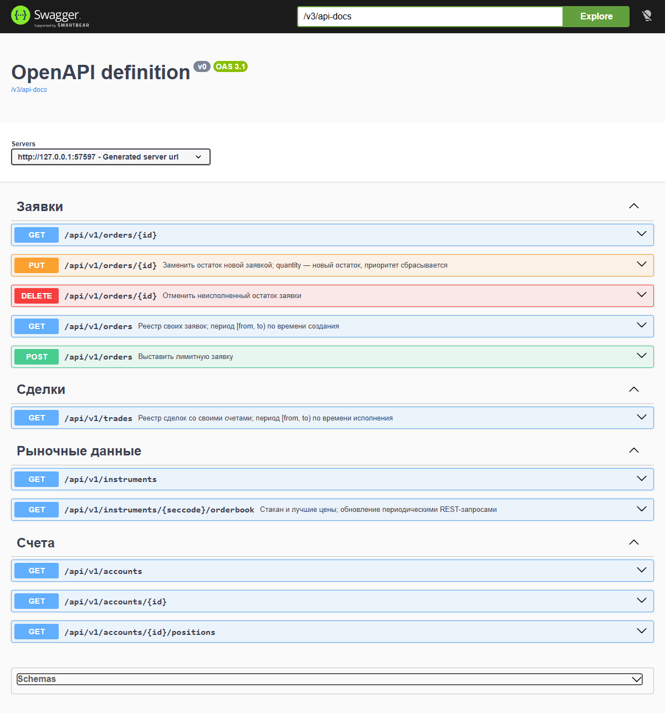
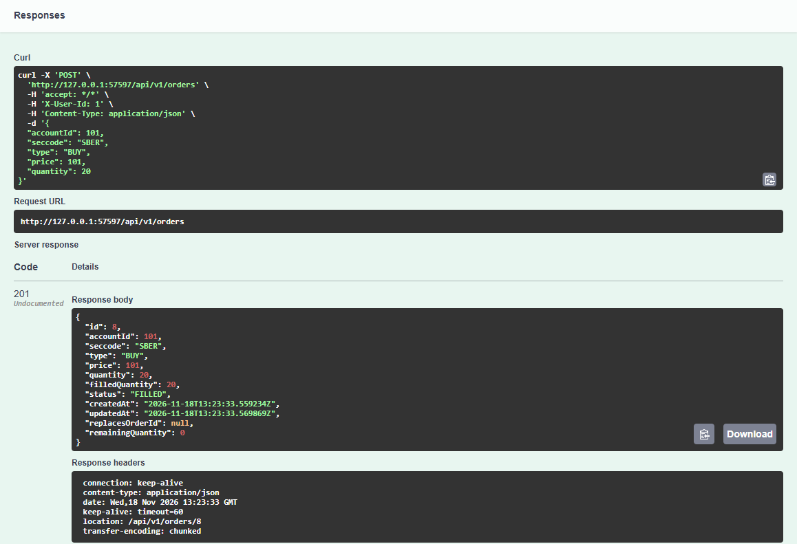
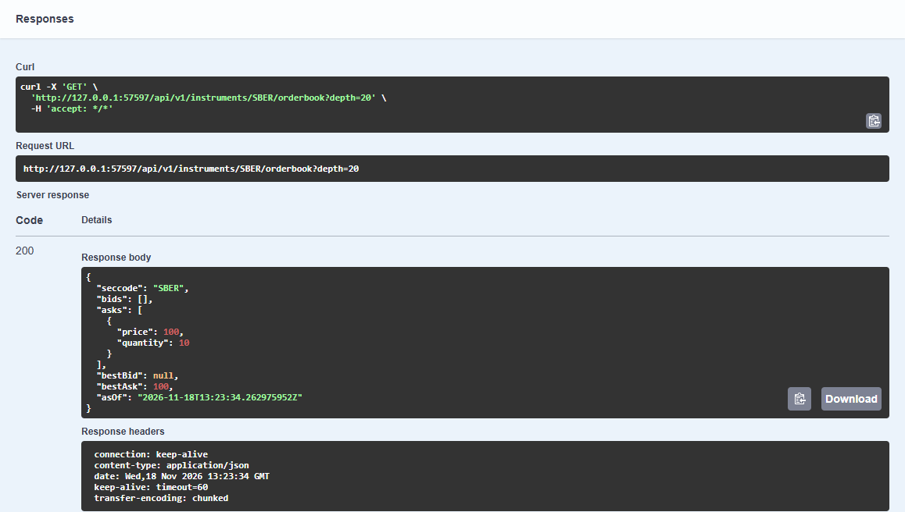

# 📈 Торговая система

REST API для торговли акциями: лимитные заявки, частичное исполнение, отмена и замена, стакан и реестры сделок.

**Стек:** Java 21 · Spring Boot 3 · Spring Data JPA · PostgreSQL · Flyway · Gradle · Lombok

[Запуск](#start) · [Демонстрация](#demo) · [Правила торгов](#rules) · [REST API](#api) · [Тесты](#tests) · [Устройство проекта](#architecture)

<a id="start"></a>

## 🚀 Запуск

### Быстрый старт в Docker

Нужен работающий Docker с Linux-контейнерами и Docker Compose v2. В каталоге проекта:

**1. Соберите и запустите приложение:**

```shell
docker compose up --build -d
```

**2. Откройте логи и дождитесь запуска:**

```shell
docker compose logs -f app
```

> 💡 При первой сборке скачиваются Gradle и зависимости. Это может занять несколько минут.

**3. После сообщения `Started TradingApplication` откройте:**

| Ссылка | Что доступно |
| --- | --- |
| [Swagger UI](http://localhost:8080/swagger-ui.html) | Описание методов и выполнение запросов |
| [OpenAPI JSON](http://localhost:8080/v3/api-docs) | Спецификация API |
| [Инструменты](http://localhost:8080/api/v1/instruments) | Справочник акций |

В Swagger методы сгруппированы по заявкам, сделкам, рыночным данным и счетам. Запросы можно выполнять прямо в браузере.



Compose включает профиль `demo`. Flyway сначала создает схему, затем загружает демонстрационные инструменты, счета и позиции. Данные сохраняются в Docker volume между запусками.

<details>
<summary>⏹️ Остановка и сброс данных</summary>

```shell
docker compose down
```

Команда останавливает проект, сохраняя данные. Для намеренного удаления **всех данных именно этого проекта** и повторного запуска с исходными демонстрационными остатками:

```shell
docker compose down -v
docker compose up --build -d
```

</details>

<details>
<summary>💻 Локальный запуск приложения</summary>

Нужен JDK 21. Установленный Gradle не требуется. `JAVA_HOME` должен указывать на JDK 21; на Windows это можно сделать для текущего PowerShell:

```powershell
$env:JAVA_HOME = 'C:\Program Files\Java\jdk-21'
docker compose up -d db
.\gradlew.bat bootRun --args='--spring.profiles.active=demo'
```

Для путей с кириллицей на Windows в `gradle.properties` включена совместимость с нативной кодировкой аргументов JVM ([ошибка Gradle](https://github.com/gradle/gradle/issues/30304)). Кодировка исходников и тестового вывода явно задана как UTF-8.

**Linux / macOS:**

```shell
docker compose up -d db
./gradlew bootRun --args='--spring.profiles.active=demo'
```

Compose публикует PostgreSQL на `127.0.0.1:55432`, приложение — на `127.0.0.1:8080`. Порт 55432 выбран, чтобы не пересекаться с обычной локальной PostgreSQL. Не запускайте одновременно контейнер приложения и локальное приложение на одном порту.

</details>

<details>
<summary>⚙️ Подключение к собственной PostgreSQL</summary>

Создайте пустую базу и пользователя с правами на создание таблиц в ней. Передайте переменные окружения:

| Переменная | Значение по умолчанию |
| --- | --- |
| `DB_URL` | `jdbc:postgresql://localhost:55432/trading` |
| `DB_USER` | `trading` |
| `DB_PASSWORD` | `trading` |
| `PORT` | `8080` |
| `SPRING_PROFILES_ACTIVE` | Не задан; для демонстрационных данных — `demo` |

Flyway сам создаст сущности в существующей базе. Без профиля `demo` создается только схема. Наполнение справочников, открытие счетов и начальное зачисление активов в рамках задания представлены демонстрационной миграцией; публичных методов произвольного зачисления денег или бумаг нет.

На базе, куда уже применена демонстрационная миграция V2, сохраняйте профиль `demo`: его отключение удалит расположение уже примененной миграции из конфигурации Flyway. Для запуска без демонстрационных данных используйте отдельную пустую базу.

</details>

<a id="demo"></a>

## 🎬 Демонстрация

### Начальные данные

Исходные данные профиля `demo`:

| Пользователь (`X-User-Id`) | Счет | Деньги | Бумаги |
| --- | --- | --- | --- |
| 1 | 101 | 100 000 RUB | Нет |
| 2 | 201 | 10 000 RUB | 1 000 SBER и 1 000 GAZP |
| 2 | 202 | 10 000 CNY | Нет; пример счета с неподходящей валютой |

Оба инструмента — акции с лотом 10 штук, шагом цены 0,01 RUB и расчетами в RUB. Цены и остатки синтетические, это не рыночные данные.

### Проверка торгового сценария

На запущенном приложении с пустым стаканом SBER выполните (нужен Python 3, дополнительных библиотек нет):

```shell
python scripts/demo.py
```

Для другого адреса: `python scripts/demo.py http://localhost:8081`.

Сценарий делает реальные REST-запросы и проверяет результаты:

1. Продавец выставляет 30 SBER по 100 RUB.
2. Покупатель выставляет покупку 20 SBER с лимитом 101 RUB.
3. Сделка исполняется по цене уже стоящей заявки — 100 RUB. Покупатель тратит 2 000 RUB, а резерв под разницу цен освобождается.
4. У продавца остается активная заявка на 10 SBER. Скрипт проверяет стакан и реестры.
5. Остаток отменяется, резерв бумаг освобождается. Проверяются денежные балансы и позиция продавца.

### ✅ Покупка исполнена

Запрос на 20 SBER с лимитом 101 RUB возвращает HTTP `201`, статус `FILLED` и нулевой неисполненный остаток.

> Поле `price` — **лимит заявки: 101 RUB**. Фактическая цена сделки в этом сценарии — **100 RUB**.



### 📊 Стакан после сделки

До отмены остатка в продаже осталось 10 SBER по 100 RUB: `asks` содержит один уровень, `bestAsk` равен 100. Заявок на покупку нет, поэтому `bids` пуст, а `bestBid` равен `null`.



Скрипт не очищает базу. Его можно повторять при достаточных остатках и пустом стакане SBER. Также приложен [requests.http](requests.http) с запросами для HTTP-клиента IDE. В запросах изменения и отмены подставляйте действительный ID активной заявки из ответа.

<a id="rules"></a>

## 📋 Правила торгов

### Заявки и обеспечение

**Область применения.** Первая версия поддерживает только акции и лимитные заявки `BUY`/`SELL`. Рыночные заявки, комиссии, плечо, короткие продажи, торговые сессии и внешние котировки не моделируются.

| Параметр | Требования |
| --- | --- |
| `quantity` | Количество **штук**, кратное `lotSize`, от 1 до 10¹² |
| `price` | Положительная цена одной акции, кратная `minStep`; до 15 цифр перед запятой и 4 после |
| Валюта счета | Совпадает с валютой инструмента; конвертации нет |

Дробное количество и неизвестные поля JSON отклоняются.

**Резервы:** покупка — `price × quantity` денег, продажа — `quantity` бумаг.

Общие остатки включают резерв: **`available = общий остаток − reserved`**.

### Сопоставление и исполнение

1. Покупка встречается с продажами **не дороже** своего лимита, продажа — с покупками **не дешевле** своего лимита.
2. Сначала выбирается лучшая цена: самая дешевая встречная продажа или самая дорогая встречная покупка.
3. При равной цене действует **FIFO** — первой исполняется раньше принятая заявка.

**FIFO.** Приоритет внутри одной цены задает ID заявки, выделяемый после получения общей транзакционной блокировки. Пропуски ID после отката допустимы и не влияют на очередность.

**Цена и объем сделки.** Цена сделки — цена встречной заявки, уже находящейся в стакане. Объем — меньший из двух неисполненных остатков. Одна заявка может породить несколько сделок.

Сопоставление выполняется **синхронно** при создании или замене заявки. Ответ возвращается после завершения транзакции. Остаток сохраняется в PostgreSQL и переживает перезапуск приложения.

**Расчеты.** При исполнении переводятся деньги и бумаги, уменьшаются соответствующие резервы. Для покупки освобождается резерв по ее лимитной цене, поэтому улучшение цены сразу увеличивает доступный остаток.

> Самосделки между счетами одного пользователя запрещены. При достижении собственной встречной заявки **вся операция откатывается**, включая уже найденные сделки. Встречная заявка сохраняется; некроссирующие заявки одного пользователя допустимы.

### Отмена, замена и статусы

| Операция | Результат |
| --- | --- |
| `DELETE /orders/{id}` | Отмена неисполненного остатка и освобождение резерва |
| Повторная отмена | Возврат состояния без повторного освобождения резерва |
| Отмена исполненной заявки | Ошибка `409` |
| `PUT /orders/{id}` | Атомарная отмена старого остатка и создание новой заявки |

При замене задаются новая цена и **новое неисполненное количество**:

- Счет, инструмент и направление сохраняются.
- Временной приоритет сбрасывается; новая заявка может сразу исполниться.
- `replacesOrderId` связывает историю.
- При ошибке старая заявка и резерв сохраняются.

**Статусы:** `ACTIVE` · `PARTIALLY_FILLED` · `FILLED` · `CANCELLED`.

У частично исполненной отмененной заявки `remainingQuantity` показывает исторический остаток, который уже не торгуется.

<a id="api"></a>

## 🔌 REST API

Базовый путь: `/api/v1`. Тела запросов и ответов — JSON. Полная схема и выполнение запросов доступны в Swagger UI.

| Метод | Путь | Назначение |
| --- | --- | --- |
| GET | `/instruments` | Справочник инструментов |
| GET | `/instruments/{seccode}/orderbook?depth=20` | Стакан, `bestBid`, `bestAsk`, время снимка |
| GET | `/accounts` | Счета пользователя |
| GET | `/accounts/{id}` | Общий, зарезервированный и доступный денежные остатки |
| GET | `/accounts/{id}/positions` | Общие, зарезервированные и доступные остатки бумаг |
| POST | `/orders` | Создание и сопоставление заявки; `201` и `Location` |
| GET | `/orders/{id}` | Своя заявка |
| DELETE | `/orders/{id}` | Отмена остатка; `200` и состояние заявки |
| PUT | `/orders/{id}` | Атомарная замена; `201`, новая заявка и `Location` |
| GET | `/orders` | Реестр своих заявок |
| GET | `/trades` | Реестр сделок с участием своих счетов |

### Доступ к данным

Инструменты и стакан публичны. Остальные методы требуют положительный заголовок:

```http
X-User-Id: 1
```

Чужие счета и заявки возвращают `404`, реестры содержат только свои данные.

> 🔑 Заголовок имитирует пользователя. **Аутентификация не реализована**; для реального развертывания идентификатор должен поступать из проверенной сервером аутентификации.

### Примеры запросов

**Создание — `POST /orders`:**

```json
{
  "accountId": 101,
  "seccode": "SBER",
  "type": "BUY",
  "price": 101,
  "quantity": 20
}
```

**Замена — `PUT /orders/{id}`:**

```json
{
  "price": 102,
  "quantity": 10
}
```

<details>
<summary>🔎 Фильтры, пагинация и стакан</summary>

Реестры поддерживают `accountId`, `seccode`, `from`, `to`, `page` (с 0) и `size` (1–100, по умолчанию 20). У заявок есть дополнительный фильтр `status`. Времена — ISO 8601 с часовым поясом, например `2026-11-17T10:00:00Z`; границы периода `[from, to)`. У заявок фильтруется время создания, у сделок — время исполнения. Сортировка: время по убыванию, затем ID по убыванию. Ответ содержит `items`, `total`, `page`, `size`.

Каждый ответ реестра использует согласованный снимок базы для количества и строк. Между отдельными запросами страниц могут появляться новые данные; offset-пагинация не фиксирует общий снимок на весь обход.

Стакан агрегирует неисполненные объемы активных заявок по цене. `depth` — число уровней с каждой стороны (1–100); покупки отсортированы по убыванию цены, продажи — по возрастанию. Если сторона пуста, ее лучшая цена — `null`. Для потока котировок клиент периодически запрашивает этот REST-метод, например раз в секунду. Это снимки текущего состояния, а не подписка на каждое изменение. `asOf` — время формирования ответа на сервере.

</details>

### Ошибки

Ошибки возвращаются как `application/problem+json` с полями `status`, `detail`, `code`; при валидации тела также `errors`:

| HTTP | Примеры `code` |
| --- | --- |
| 400 | `VALIDATION_ERROR`, `INVALID_REQUEST`, `INVALID_ORDER` |
| 404 | `NOT_FOUND` |
| 409 | `INSUFFICIENT_FUNDS`, `INSUFFICIENT_SECURITIES`, `ORDER_NOT_ACTIVE`, `SELF_TRADE` |
| 503 | `TEMPORARILY_UNAVAILABLE` |

Автоматических повторов POST и PUT нет. Идемпотентный ключ не реализован: после потери ответа нельзя слепо повторять создание или замену; сначала проверьте реестр и состояние заявки.

<a id="tests"></a>

## 🧪 Проверка и сборка

Нужны JDK 21 и работающий Docker. Интеграционные тесты через Spring Boot `@ServiceConnection` и Testcontainers поднимают отдельную PostgreSQL 16 на случайном порту, применяют настоящие миграции и не используют базу из Compose. При недоступном Docker тесты падают, а не пропускаются.

**Windows:**

```powershell
.\gradlew.bat clean test bootJar
```

**Linux / macOS:**

```shell
./gradlew clean test bootJar
```

| Набор тестов | Что проверяет |
| --- | --- |
| `OrderLifecycleIntegrationTest` | Цену исполнения, FIFO, частичное исполнение, резервы, отмену, замену и откат при самосделке |
| `TradingApiIntegrationTest` | REST API, валидацию, доступ к данным, фильтры и OpenAPI |
| `ConcurrentTradingIntegrationTest` | Одновременный расход активов, двойное исполнение и гонку отмены с исполнением |

Дополнительно сверяются суммарные активы и соответствие резервов активным заявкам. Фикстуры загружаются через `@Sql`; `DatabaseState` читает зафиксированное состояние через JPA.

- **Отчет:** `build/reports/tests/test/index.html`
- **JAR:** `build/libs/spvb-trading.jar`

Запуск собранного приложения:

```shell
java -jar build/libs/spvb-trading.jar --spring.profiles.active=demo
```

<a id="architecture"></a>

## 🗂️ Устройство проекта

```text
src/main/java/ru/spvb/trading/
  api/                  контроллеры по ресурсам и обработка ошибок
    dto/
      account/          ответы по счетам и позициям
      order/            запросы, фильтр и ответ по заявкам
      trade/            фильтр и ответ по сделкам
      market/           инструменты и стакан
      common/           общие фильтры и страница результатов
  domain/
    account/            счет, позиция и ее составной ключ
    order/              заявка, условия, сторона и статус
    trade/              сделка
    market/             инструмент
    TradingException    общая бизнес-ошибка
  persistence/
    repository/         Spring Data JPA репозитории бизнес-сущностей
    specification/      фильтры реестров и подбор встречной заявки
    locking/            строка блокировки торгов и ее репозиторий
  service/
    account/            чтение счетов и позиций
    order/              жизненный цикл заявки, сопоставление, расчеты и чтение
    trade/              чтение реестра сделок
    market/             инструменты и котировки
    TradingAccess       общие проверки доступа к торговым данным
src/main/resources/db/
  migration/     схема Flyway
  demo/          демонстрационные данные
src/test/        интеграционные проверки PostgreSQL и REST
scripts/demo.py  воспроизводимый сценарий через HTTP
requests.http    примеры ручных запросов
```

<details>
<summary>🛠️ Модель данных и транзакции</summary>

Схему создает Flyway: `db/migration/V1__trading_schema.sql`. Демонстрационные данные вынесены в профиль `demo`: `db/demo/V2__demo_data.sql`. Миграция `db/migration/V3__trading_lock.sql` добавляет общую строку блокировки торгов. Hibernate проверяет соответствие сущностей схеме (`ddl-auto: validate`), но не изменяет ее.

Таблицы:

- `instruments`: код, тип, лот, шаг цены и валюта расчетов.
- `accounts`: владелец, валюта, денежный баланс и резерв.
- `positions`: общий остаток и резерв инструмента на счете.
- `orders`: лимитная цена, исходное и исполненное количества, статус, времена, ссылка на замененную заявку.
- `trades`: инструмент, обе заявки, фактическая цена, количество и время.
- `trading_lock`: единственная строка для сериализации торговых операций через JPA.

Деньги обрабатываются через `BigDecimal` и PostgreSQL `numeric`; округления при расчетах не требуется. Ограничения базы запрещают отрицательные остатки, резерв сверх общего остатка и несовместимые статусы заявок. Есть внешние ключи и индексы стакана и реестров.

Все изменяющие операции сначала получают **одну общую блокировку строки** `trading_lock` через Spring Data JPA `@Lock(PESSIMISTIC_WRITE)`. Блокировка удерживается до commit/rollback. После этого проверяются свободные активы, резервируется остаток, выбираются встречные заявки и выполняются расчеты. Поэтому порядок захвата блокировок одинаков, а параллельные запросы и несколько экземпляров приложения не расходуют один остаток повторно. Ожидание блокировки ограничено 10 секундами настройкой PostgreSQL `lock_timeout` для подключений пула.

Это осознанное ограничение пропускной способности для небольшого тестового приложения: изменения разных инструментов тоже сериализуются. Блокировка по инструменту без дополнительного протокола счетов была бы недостаточна, поскольку один счет может торговать несколькими инструментами. Прямые записи в таблицы вне этого протокола во время торгов не поддерживаются.

Чтение выполняется в транзакциях `REPEATABLE READ` без блокировки торгов; обе стороны стакана и страницы реестров согласованы внутри запроса. Вся операция создания/изменения/отмены атомарна, включая сделки, деньги, позиции, статусы и резервы.

Доступ к данным реализован через Spring Data JPA: отдельные репозитории сущностей, Specifications для фильтров и подбора встречной заявки, `PageRequest` для сортировки и пагинации. Для агрегации стакана используется JPQL-проекция. В прикладном коде нет ручных JDBC-запросов, `RowMapper`, `ResultSet` или сборки SQL-строк. PostgreSQL JDBC-драйвер и URL подключения остаются инфраструктурой Hibernate и Flyway.

`OrderService` управляет жизненным циклом заявки и границей транзакции. `MatchingService` выбирает встречные заявки и проверяет самосделки. `SettlementService` резервирует активы и выполняет расчеты. Объекты `Account`, `Position` и `Order` содержат именованные операции изменения состояния. Общие проверки владения счетом и заявкой собраны в `TradingAccess`.

Контроллеры разделены на заявки, сделки, счета и рыночные данные. `OrderFilter` и `TradeFilter` принимаются через `@ModelAttribute`, валидируются Bean Validation и передаются между слоями целиком. Общие параметры периода и пагинации находятся в `RegisterFilter`. В ответах используются отдельные DTO-records, JPA-сущности наружу не передаются. `open-in-view` отключен.

Lombok используется для конструкторов зависимостей, геттеров сущностей, DTO фильтров и логгера. У сущностей нет общедоступных сеттеров и автоматически сгенерированного `equals`/`hashCode`; равенство по полям задано только для составного ключа `PositionId`.

</details>
